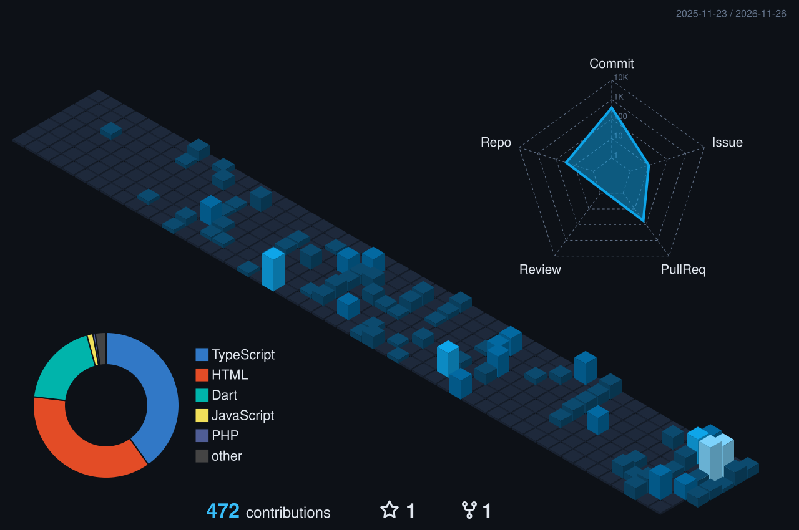

  

  

  

 

  I'm a <strong>Software Engineer</strong> specialized in <strong>Full-Stack Development</strong> and <strong>DevSecOps</strong>, passionate about building secure, scalable products and exploring the intersection of <strong>Mobile Development</strong>, <strong>Cloud Infrastructure</strong>, and <strong>Software Security</strong>.
    
  My work focuses on turning complex requirements into reliable, maintainable solutions — from pixel-perfect Flutter, Kotlin and Swift apps to automated CI/CD pipelines, containerized deployments, and security built into every stage of the delivery lifecycle.

 

---

### 🚀 At a Glance

| | |
| :--- | :--- |
| **🎓 Education** | Bachelor's Degree in Computer Science — Software Engineering, American University of Kinshasa |
| **💼 Experience** | 3 years of software engineering & application development (Web, Mobile & Desktop) |
| **🔐 Specialization** | Full-Stack Development · DevSecOps · CI/CD Automation · Containerized Deployments |
| **🔭 Interests** | Pixel-perfect UI/UX design, performance optimization, and modular software architecture |
| **🌱 Currently Learning** | Cloud Security · Kubernetes · Machine & Deep Learning · Neural Networks |

> *"Software should be invisible — it just works seamlessly."*

---

### 🎓 Certifications & Training

| Organization | Certification / Training |
| :--- | :--- |
| **Orange Digital Center** | Python for Data Science, AI & Development |
| **Orange Digital Center** | Full-Stack Development Training — Laravel, Angular, Dart & Flutter |
| **Udemy** | Angular — Specialization in Signals |
| **Udemy** | Flutter with Riverpod & Clean Architecture |
| **The Linux Foundation** | Introduction to Kubernetes (LFS158) |
| **Cisco Networking Academy** | Python Essentials 1 & 2 |

---

### 📬 Connect with me

  
  
  

---

### 🛠️ Tech Stack

| Domain | Technologies |
| :--- | :--- |
| **📱 Mobile Development** |  |
| **🎨 Frontend** |  |
| **⚙️ Backend** |  |
| **🗄️ Databases & BaaS** |  |
| **🔐 DevSecOps & CI/CD** |  |
| **☁️ Cloud, Infra & Monitoring** |  |

---

### 📈 GitHub Analytics

  
  

 

  

---

### 🧊 3D Contribution Calendar

  

---

### 📊 GitHub Activity Graph

  

---

### 🐍 Contribution Snake

  

  

